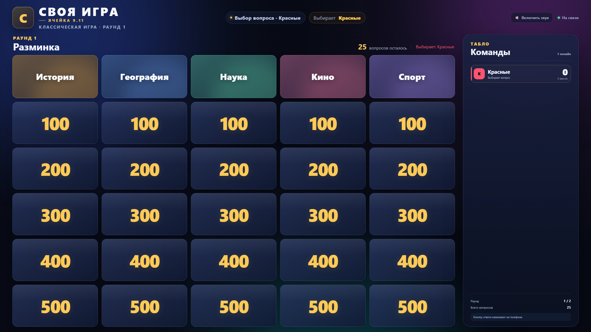
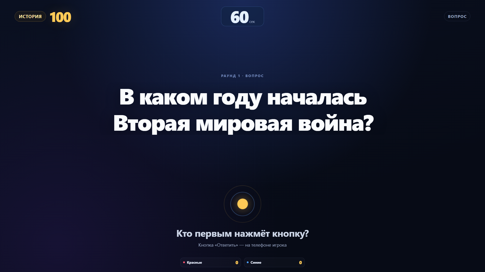
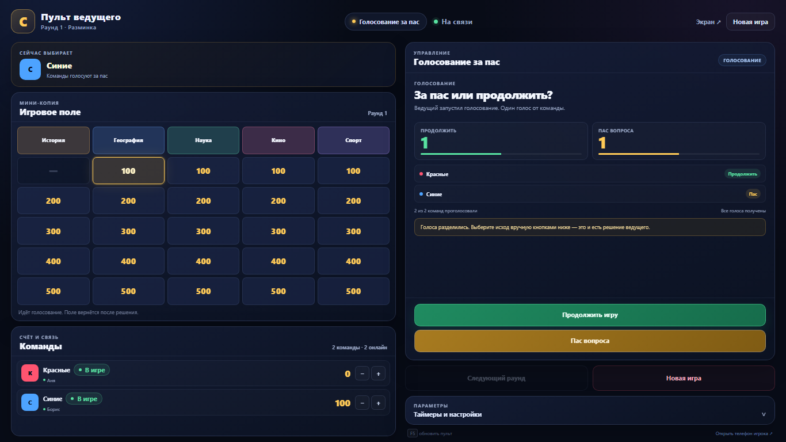
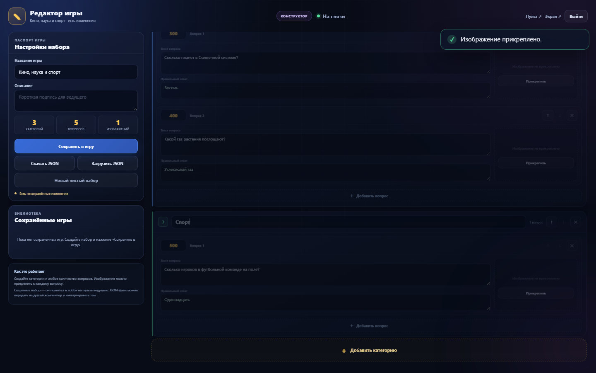
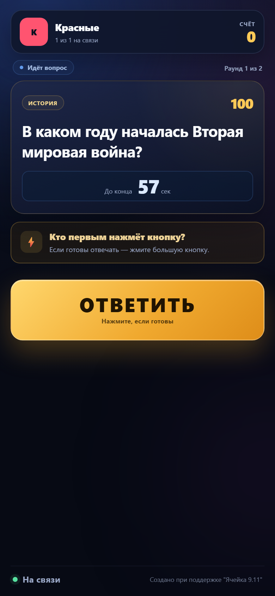
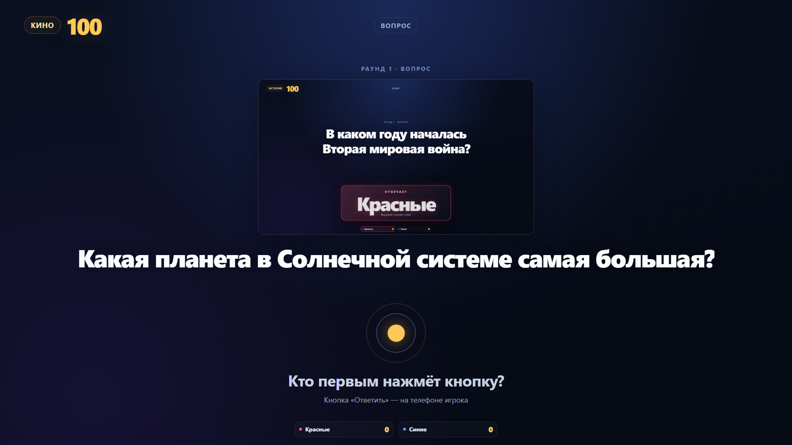
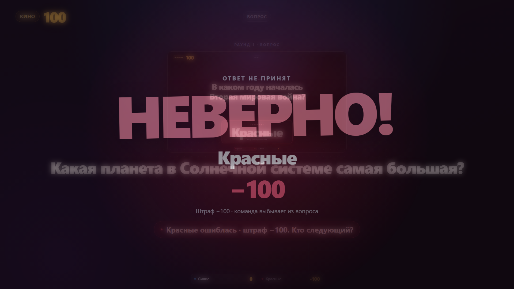
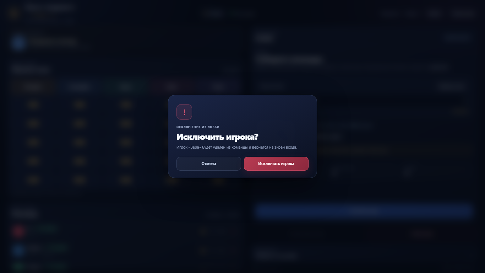

<div align="center">

# СВОЯ ИГРА · ЯЧЕЙКА 9.11

**Локальная «Своя игра» для компьютера ведущего, проектора и телефонов игроков.**
**A local Jeopardy-style game for the host computer, projector and players' phones.**

[Русский](#русский) · [English](#english)


</div>



---

## Русский

### О проекте

Полностью рабочий прототип клубной «Своей игры» для одного компьютера ведущего и телефонов игроков в одной Wi-Fi сети. Всё синхронизируется мгновенно через Socket.IO.

| Интерфейс | Назначение |
| --- | --- |
| **`/screen`** | Большой экран или проектор: игровое поле, вопрос, табло команд, голосование, финал |
| **`/host`** | Пульт ведущего: мини-поле, оценки ответов, голосование, таймеры, счёт. Защищён паролем |
| **`/player`** | Телефон игрока: вход в команду, большая кнопка ответа, голосование за пас |
| **`/editor`** | Конструктор своих игр: категории, вопросы, изображения, импорт/экспорт JSON. Защищён паролем |

### Возможности

- Два раунда классической игры по 5 тем × 5 вопросов.
- Свои игры: любое количество категорий и вопросов.
- Текстовые вопросы и вопросы с изображениями.
- Выбор игрового набора в лобби.
- Экспорт игры в JSON и импорт обратно — включая изображения.
- Мгновенная синхронизация `/screen`, `/host` и `/player`.
- Фиксация первого нажатия на сервере.
- Блокировка ошибившихся команд до конца вопроса.
- Голосование за пас с подсчётом голосов в реальном времени.
- Таймеры вопроса, ответа команды и голосования.
- Ручное открытие кнопок ведущим: кнопки закрыты до команды «Разрешить ответы».
- Показ правильного ответа после верного ответа и после паса/пропуска вопроса.
- Автоподгонка размера шрифта для длинных вопросов — без прокрутки на большом экране.
- Настройка штрафа за неверный ответ.
- QR-код для подключения телефонов.
- Восстановление сессии игрока после обрыва связи.
- Исключение отдельных игроков и целых команд из лобби ведущим.
- Звуковые эффекты на большом экране.
- Адаптивные интерфейсы под проектор, ноутбук и телефон.
- Единый брендинг «ЯЧЕЙКА 9.11» на всех основных экранах.

### Скриншоты

| Экран показа | Пульт ведущего |
| --- | --- |
|  |  |

| Редактор игры | Телефон игрока |
| --- | --- |
|  |  |

| Вопрос с изображением | Штраф за неверный ответ |
| --- | --- |
|  |  |

Больше скриншотов: [вход в пульт](docs/screenshots/host-password.png), [нажатие команды](docs/screenshots/screen-buzz.png), [подтверждение новой игры](docs/screenshots/new-game-confirm.png), [финал](docs/screenshots/screen-final.png).

### Быстрый запуск

Нужен **Node.js 18+** (проверено на Node.js 24).

#### Windows — двойной клик

Запустите:

```text
start-server.bat
```

Файл:

1. проверит Node.js и npm;
2. при необходимости выполнит `npm install`;
3. запустит сервер;
4. автоматически откроет `/host` и `/screen` в браузере.

Не закрывайте окно с сервером во время игры. Если браузер не открылся сам, откройте адреса вручную.

#### Любая ОС — вручную

```bash
cd D:\sgame
npm install
npm start
```

После запуска:

- **Экран показа:** `http://localhost:3000/screen`
- **Пульт ведущего:** `http://localhost:3000/host`
- **Редактор:** `http://localhost:3000/editor`
- **Телефон игрока:** `http://<IP-компьютера>:3000/player`
- **Стартовая страница:** `http://localhost:3000/`

Сервер слушает порт **3000** и все сетевые интерфейсы (`0.0.0.0`).

### Пароль

Пульт `/host` и редактор `/editor` защищены общим паролем. По умолчанию:

```text
svoya
```

Смените пароль перед реальной игрой.

PowerShell:

```powershell
$env:HOST_PASSWORD = "мой-надёжный-пароль"
npm start
```

`cmd`:

```bat
set HOST_PASSWORD=мой-надёжный-пароль
npm start
```

После перезапуска сервера старые сессии пульта и редактора потребуют ввести новый пароль.

### Как провести игру

#### 1. Лобби

1. Откройте `/screen` и `/host`.
2. Введите пароль ведущего на пульте.
3. Выберите игровой набор: классику или свою игру.
4. Игроки сканируют QR-код с экрана и открывают `/player`.
5. На телефоне вводят имя, выбирают существующую команду или создают новую.
6. Несколько игроков могут войти в одну команду — кнопка ответа у команды общая.
7. Ведущий нажимает **«Начать игру»**.

В лобби на экране видны QR-код, адрес, IP и список команд.

#### 2. Выбор вопроса

- Очередь выбора видна на `/screen` и `/host`: «Сейчас выбирает: …».
- Команда называет тему и стоимость.
- Ведущий кликает по ячейке на мини-поле.
- Вопрос ещё не виден игрокам: ведущий видит текст, ответ и изображение в превью.
- Кнопка **«Показать вопрос»** выводит вопрос на `/screen` и активирует кнопки на телефонах.
- Если включён режим «Кнопки открывает ведущий», после показа вопроса кнопки остаются закрытыми до нажатия **«Разрешить ответы»**.

#### 3. Ответ

- Первое нажатие фиксируется сервером мгновенно.
- На `/screen` появляется крупная плашка «Отвечает: Команда».
- У остальных команд кнопка блокируется.
- После нажатия запускается таймер ответа; когда он истекает, ответ автоматически считается неверным.
- Ведущий нажимает **«Верно»** или **«Неверно»**.
- **Верно:** баллы начисляются, правильный ответ показывается на экране и телефонах, затем вопрос закрывается.
- **Неверно:** команда блокируется до конца вопроса; при включённом штрафе снимается стоимость вопроса.

#### 4. Голосование за пас

- Если все команды в сети ошиблись, голосование запускается автоматически.
- Ведущий может запустить его вручную в любой момент.
- На телефонах появляются две кнопки: **«Продолжить»** и **«Пас вопроса»**.
- Один голос от команды; повторное голосование запрещено.
- Результаты видны на `/screen` и `/host` в реальном времени.
- При явном большинстве и включённом таймере результат применяется автоматически.
- При ничьей решение принимает ведущий.
- **Продолжить:** блокировки снимаются, вопрос продолжается.
- **Пас:** вопрос закрывается без баллов, правильный ответ показывается на экране и телефонах.

#### 5. Раунды и финал

- Классическая игра: два раунда по 25 вопросов.
- Своя игра из редактора: один раунд с любым количеством вопросов.
- После раунда показывается таблица, ведущий может нажать **«Следующий раунд»**.
- После последнего раунда показывается финальная таблица и победитель.
- **«Новая игра»** сбрасывает поле и счёт, возвращает всех в лобби и сохраняет команды. Действие подтверждается диалогом.

### Редактор своих игр

Откройте `/editor` и введите пароль ведущего.

Можно:

- создавать любое количество категорий;
- добавлять любое количество вопросов;
- задавать стоимость каждого вопроса;
- указывать текст вопроса и правильный ответ;
- прикреплять PNG/JPEG/WebP/GIF;
- сохранять набор в библиотеку;
- выбирать набор на пульте;
- импортировать JSON прямо в лобби ведущего;
- скачивать и загружать JSON;
- удалять сохранённые наборы.

Изображения автоматически уменьшаются и пережимаются в браузере. В JSON они встраиваются в base64, поэтому файл можно перенести на другой компьютер без отдельных папок.

Сохранённые игры находятся в `data/custom-games.json` и переживают перезапуск сервера.

### Исключение из лобби

В лобби ведущий может:

- исключить отдельного игрока кнопкой `×` рядом с его именем;
- исключить всю команду кнопкой `✕` в строке команды;
- освободить место для новых игроков;
- удалить команду, которая потеряла связь.

Оба действия доступны только в лобби и требуют подтверждения. Исключённые игроки автоматически возвращаются на экран входа.



### Настройки ведущего

| Настройка | Описание |
| --- | --- |
| Таймер вопроса | Включение и длительность таймера на обдумывание |
| Таймер ответа команды | Запускается после нажатия кнопки; по истечении ответ считается неверным |
| Таймер голосования | Включение и длительность голосования |
| Штраф за неверный ответ | Отнимать стоимость вопроса при ошибке |
| Кнопки открывает ведущий | Кнопки закрыты до нажатия «Разрешить ответы» |

Дополнительно на пульте доступны:

- начисление и снятие 100 баллов вручную;
- передача выбора следующей команде;
- исключение игроков и команд из лобби;
- выбор игрового набора;
- импорт `.json`;
- новая игра без перезапуска сервера.

### Сетевой доступ

Узнать IP компьютера в Windows:

```powershell
Get-NetIPAddress -AddressFamily IPv4 |
  Where-Object { $_.IPAddress -notlike '127.*' } |
  Select-Object IPAddress, InterfaceAlias
```

Или:

```bat
ipconfig
```

Если автоматически выбран неверный адаптер (VPN, Hyper-V, VirtualBox), задайте IP явно:

```powershell
$env:HOST_IP = "192.168.0.102"
npm start
```

### Если телефоны не подключаются

1. Телефон и компьютер должны быть в одной Wi-Fi сети.
2. В адресе телефона должен быть IP компьютера, а не `localhost`.
3. Разрешите Node.js входящие подключения в частной сети Windows Firewall.
4. Отключите VPN или задайте `HOST_IP` вручную.
5. Проверьте, что в Wi-Fi не включена изоляция клиентов.

Правило брандмауэра (PowerShell от администратора):

```powershell
New-NetFirewallRule -DisplayName "Своя игра 3000" -Direction Inbound -Protocol TCP -LocalPort 3000 -Action Allow -Profile Private
```

### Архитектура

- **Backend:** Node.js, Express, Socket.IO.
- **Frontend:** ванильные HTML/CSS/JS, без сборщика.
- **Партия:** хранится в памяти сервера.
- **Свои игры:** сохраняются на диск в `data/custom-games.json`.
- **Пароль:** `/host` и `/editor` получают временный токен после проверки `HOST_PASSWORD`.
- **Изображения:** уменьшаются через Canvas, хранятся в JSON и раздаются отдельным HTTP-маршрутом.
- **Сервер авторитетен:** проверяет первое нажатие, блокировки, голоса, таймеры, штрафы и переходы фаз.
- **Ролевые данные:** до раскрытия ответа экран не получает правильный ответ; игрок получает только своё состояние.
- **Таймеры:** считаются на сервере по `endsAt`.

Основные фазы:

```text
lobby → themeSelect → question → voting → finished
```

Внутри вопроса: `selected → shown → buzzed → result`, а для паса/пропуска — `revealed` (показ правильного ответа перед закрытием).

#### Socket.IO-события

Клиент → сервер:

```text
auth:login, join, startGame, selectQuestion, showQuestion, unlockBuzz, buzz,
judgeAnswer, startVoting, vote, finishVoting, closeQuestion,
nextSelector, nextRound, newGame, adjustScore, updateSettings,
removeTeam, selectGameSet, importGameSet, saveGameSet,
getGameSet, deleteGameSet
```

Сервер → клиенты:

```text
screen:state, host:state, player:state, lobby:state, editor:state
```

### Структура проекта

```text
.
├─ start-server.bat          # быстрый запуск в Windows
├─ server.js                 # Express + Socket.IO + игровая логика
├─ lib/custom-games.js       # сохранение и валидация своих игр
├─ data/questions.js         # встроенная классика
├─ data/custom-games.json    # созданные игры (после первого сохранения)
├─ public/
│  ├─ index.html
│  ├─ screen.html
│  ├─ host.html
│  ├─ player.html
│  ├─ editor.html
│  ├─ css/
│  └─ js/
├─ test/smoke.js             # end-to-end проверка Socket.IO
├─ docs/screenshots/
├─ package.json
└─ README.md
```

### Тесты

```bash
npm test
```

Smoke-тест поднимает отдельный сервер на порту **3107** и проверяет **33 сценария**:

- авторизация пульта и редактора;
- вход команд;
- старт и выбор вопроса;
- показ вопроса;
- buzz и запрет повторного нажатия;
- верный и неверный ответ;
- показ правильного ответа после верного ответа и после паса;
- штраф;
- автоматическое голосование;
- запрет повторного голоса;
- ничья и решение ведущего;
- счёт;
- переподключение;
- завершение раунда;
- следующий раунд;
- новая игра;
- таймеры вопроса, ответа команды и голосования;
- ручная блокировка и открытие кнопок ведущим;
- создание игры с изображением;
- выбор игрового набора;
- импорт и удаление игры;
- исключение отдельных игроков и команд из лобби.

Интерфейсы дополнительно проверены в Chromium (Microsoft Edge) при разрешениях **1920×1080**, **1440×900**, **1366×768** и **390×844**: пароль, редактор, загрузка и сжатие изображения, экспорт/импорт JSON, штраф, новая игра, импорт файла с пульта, исключение игроков и команд, а также подписи «ЯЧЕЙКА 9.11» — без ошибок в консоли.

### Ограничения

- Это локальный прототип, а не интернет-сервис.
- Нет HTTPS и полноценной системы пользователей.
- Состояние партии сбрасывается при перезапуске сервера.
- Новые игроки не могут войти посреди игры (переподключение существующих работает).
- «Новая игра» сохраняет команды; для полного сброса перезапустите сервер.
- Пароль по умолчанию `svoya` — обязательно смените его.
- Звук на `/screen` включается кнопкой из-за ограничений браузеров.
- Своя игра из редактора содержит один раунд.

---

## English

### About

A complete local prototype of a Jeopardy-style quiz game for one host computer and players' phones on the same Wi-Fi network. All screens are synchronized in real time through Socket.IO.

| Interface | Purpose |
| --- | --- |
| **`/screen`** | Projector / TV view: board, question, scoreboard, voting, final results |
| **`/host`** | Host control panel: mini board, answer judging, voting, timers, scores. Password-protected |
| **`/player`** | Phone view: join a team, buzz, vote. No password |
| **`/editor`** | Custom game builder: categories, questions, images, JSON import/export. Password-protected |

### Features

- Two classic rounds, 5 categories × 5 questions each.
- Custom games with unlimited categories and questions.
- Text questions and image questions.
- Game set selection in the lobby.
- JSON export/import including embedded images.
- Real-time `/screen`, `/host` and `/player` synchronization.
- Server-side first-buzz detection.
- Wrong teams are locked until the end of the question.
- Real-time pass voting.
- Question, team-answer and voting timers.
- Host-controlled buzz unlocking: buttons stay locked until “Allow answers”.
- The correct answer is revealed after a correct answer and after a pass/skip.
- Automatic font fitting for long questions — no scrolling on the big screen.
- Optional score penalty for a wrong answer.
- QR code for player access.
- Player session recovery after disconnect.
- Host can remove individual players or entire teams from the lobby.
- Sound effects on the big screen.
- Responsive layouts for projector, laptop and phone.
- Unified “ЯЧЕЙКА 9.11” branding across the main screens.

### Quick start

Requires **Node.js 18+** (tested on Node.js 24).

#### Windows

Double-click:

```text
start-server.bat
```

The launcher checks Node.js/npm, installs dependencies if needed, starts the server and opens `/host` and `/screen` in the browser.

#### Manual start

```bash
npm install
npm start
```

Open:

- **Screen:** `http://localhost:3000/screen`
- **Host:** `http://localhost:3000/host`
- **Editor:** `http://localhost:3000/editor`
- **Player:** `http://<HOST_IP>:3000/player`
- **Landing page:** `http://localhost:3000/`

The server listens on port **3000** and all network interfaces.

### Password

`/host` and `/editor` share the host password. The default is:

```text
svoya
```

Change it before a real game.

PowerShell:

```powershell
$env:HOST_PASSWORD = "your-strong-password"
npm start
```

`cmd`:

```bat
set HOST_PASSWORD=your-strong-password
npm start
```

### Game flow

1. Open `/screen` and `/host`; enter the host password.
2. Choose the built-in game or a custom game.
3. Players scan the QR code and join/create a team on `/player`.
4. Start the game.
5. The current team picks a category and value.
6. The host clicks the cell and shows the question. If manual buzz control is on, the host then clicks “Allow answers”.
7. The first team to buzz is shown on the big screen; the answer timer starts.
8. The host judges the answer as correct or wrong. A timeout counts as wrong.
9. A correct answer reveals the correct answer; a pass/skip also reveals it before the question closes.
10. If all teams fail, a pass vote starts automatically.
11. Continue or pass according to the vote; a tie is decided by the host.
12. After all questions, the final scoreboard and winner are shown.

### Custom games

Open `/editor` and enter the host password. You can add any number of categories and questions, set values, include correct answers, and attach images. Games can be saved to the server library, selected on the host panel, exported to JSON, imported back, or imported directly from the host lobby.

Saved games are stored in `data/custom-games.json` and survive server restarts. Images are compressed in the browser and embedded into the JSON.

### Lobby moderation

The host can remove a single player with the `×` button next to their name or remove an entire team with the `✕` button in the team row. Both actions are available in the lobby and require confirmation. Removed players are returned to the join screen.

### Settings

- Question timer: on/off and duration.
- Team answer timer: starts after a buzz; expiry counts as a wrong answer.
- Voting timer: on/off and duration.
- Wrong-answer penalty: subtract the question value on a wrong answer.
- Host-controlled buzz lock: buttons stay locked until the host allows answers.
- Manual score adjustment: ±100 points.
- Remove individual players or entire teams from the lobby.
- Next selector, game set selection, JSON import, new game.

### Networking

Find the computer's LAN IPv4 address (`ipconfig` on Windows). Phones must be on the same Wi-Fi network. Allow Node.js through Windows Firewall for private networks.

If the automatically selected IP is wrong:

```powershell
$env:HOST_IP = "192.168.0.102"
npm start
```

### Architecture

- Node.js + Express + Socket.IO.
- Vanilla HTML/CSS/JS, no build step.
- Game state is held in server memory.
- Custom games are persisted on disk.
- Host/editor authentication uses a server-issued session token after password verification.
- Images are served through a dedicated HTTP route to avoid sending base64 through every Socket.IO update.
- The server is authoritative for buzzes, locks, votes, timers, penalties and phase transitions.
- Role-specific state is sent to screen, host, players and editor.

### Tests

```bash
npm test
```

The smoke test starts an isolated server on port **3107** and runs **33 scenarios**, including authentication, gameplay, all timers, answer reveal, manual buzz unlocking, penalties, image questions, custom games, import/export, lobby removal and new game. Browser UI checks were also run in Chromium/Edge at 1920×1080 and 1440×900, including long-question fitting, host question previews, answer reveal and removed players’ return to the join screen.

### Limitations

- Local-network prototype, not an internet service.
- No HTTPS or full user accounts.
- Game state is lost on server restart.
- New players cannot join mid-game; existing players can reconnect.
- New game keeps teams; restart the server to clear them completely.
- Change the default password.
- Screen audio requires a click to enable.
- Custom games created in the editor contain one round.

---

<div align="center">

**Сделано для игры, друзей и хороших вопросов.**
**Made for games, friends and good questions.**

</div>

Для бесплатного распространения. Все права защищены Сальников Дмитрий и ЯЧЕЙКА 9.11
